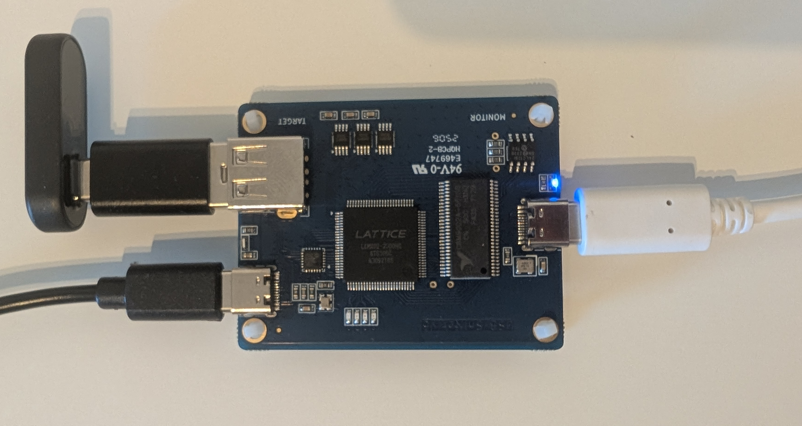

+++
date = '2025-07-04T10:31:25+02:00'
title = 'USB Audio Sniffer'
ShowToc = true
+++

I recently started using USB wireless headphones when playing games on my
Nintendo Switch 2, so I can fully enjoy 3D audio. These come with a USB adapter
which connects to the console and presents itself as a USB audio device. This
adapter then connects to the wirless headphones via 2.4 GHz for reduced
latency.

The issue? I like to stream my gameplay to YouTube using an HDMI capture card
and the Nintendo Switch 2 can't output audio to multiple devices at the same
time. So I can choose between audio going through HDMI to the capture card or
through USB to my ears, but not both 🤦.

I reported the issue to Nintendo, but creating an audio sniffer was faster 🤐.

# The plan

After doing some thinking, I figured that the best way would be to capture the
audio data going through USB passively (to not increase latency) and make it
usable to OBS Studio on my computer, where I also have the HDMI capture
connected and from where everything is streamed to YouTube.

I don't feel like trying to reverse engineer the wireless protocol of my
headphones — and it might be encrypted anyway — so I decided to search for USB
sniffer devices online. That search was REALLY successful. Alex Taradov created
a low-cost and fully open source
[usb-sniffer](https://github.com/ataradov/usb-sniffer).
Hardware layout files, FPGA firmware, MCU firmware and PC software are all open
source. The code is very easy to understand as well, so reading the data with
my own tool instead of sending it to Wireshark should not be an issue.

# The Hardware

The hardware is available from several shops on AliExpress. None of the shops
have a ton of ratings, but I found one that I found trustworthy enough.
Additionally, it happened to be summer sale time, so I only paid 37.19 EUR
instead of 55.51 EUR 🎉. So here it is:



The USB wireless adapter is connected directly to the USB-A port and the USB-C
port on the left is connected to the Switch 2 through the very short cable that
was included. Keeping the USB wires between the device to be sniffed and the
USB host short, seems to be very important to maintain signal integrity when
using such sniffers. I didn't experience such issues myself, but the GitHub
usb-sniffer repository has a few issue reports related to that. The cable on
the right goes into my computer, where I want to capture the audio data.

# Exploring using Wireshark

Using the USB sniffer with Wireshark is very easy. You just compile the
provided software using `make`, copy the resulting binary to your personal
extcap directory and done. Now there is a `USB Sniffer` source. This is what it
showed after connecting the sniffer (with the USB wireless adapter attached) to
my Switch 2:



First, the usual USB initialization and then lots of USB endpoint data going
from the host to the device. That certainly looks like audio data, because the
payload becomes all zeroes as soon as I pause the game to stop audio from
playing.

But what's the format of that audio data? I connected the USB wireless adapter
to my PC to look at `lsusb -v -d 1038:230a` (redacted for readability):

```
Bus 007 Device 026: ID 1038:230a SteelSeries ApS Arctis GameBuds
Negotiated speed: Full Speed (12Mbps)
Device Descriptor:
  Configuration Descriptor:
    Interface Descriptor:
      bInterfaceClass         1 Audio
      bInterfaceSubClass      1 Control Device
      AudioControl Interface Descriptor:
        bLength                12
        bDescriptorType        36
        bDescriptorSubtype      2 (INPUT_TERMINAL)
        bTerminalID            38
        wTerminalType      0x0101 USB Streaming
        bAssocTerminal          0
        bNrChannels             2
        wChannelConfig     0x0003
          Left Front (L)
          Right Front (R)
        iChannelNames           0
        iTerminal               0
    Interface Descriptor:
      bInterfaceClass         1 Audio
      bInterfaceSubClass      2 Streaming
      AudioStreaming Interface Descriptor:
        wFormatTag         0x0001 PCM
      AudioStreaming Interface Descriptor:
        bDescriptorType        36
        bDescriptorSubtype      2 (FORMAT_TYPE)
        bFormatType             1 (FORMAT_TYPE_I)
        bNrChannels             2
        bSubframeSize           2
        bBitResolution         16
        bSamFreqType            1 Discrete
        tSamFreq[ 0]        48000
```

There you can see that it's just raw PCM data with 16 bits per channel and 2
channels per sample. The sample frequency is 48000 Hz. I don't know if and
where this tells me the endianness, but I guessed it and it seems to be little
endian. In other words: It's 48 kHz `S16LE` PCM.

# My tool

So how do I get this data into OBS Studio? Well, I only need to support Linux,
where it's very easy to create a virtual audio source that's usable by all
programs just like a real microphone: Using PipeWire.

Luckily, there are Rust crates for both USB and PipeWire, because in C, making
the code both simple and performant at the same time, would be more work than I
wanted to invest in this.

So, creating a virtual audio source works exactly the same as the official
`audio-src sample`
([C](https://github.com/PipeWire/PipeWire/blob/1.4.6/src/examples/audio-src.c),
[Rust](https://gitlab.freedesktop.org/PipeWire/PipeWire-rs/-/blob/v0.8.0/PipeWire/examples/tone.rs?ref_type=tags)),
but with the stream properties taken from
[module-example-source.c](https://github.com/PipeWire/PipeWire/blob/1.4.6/src/modules/module-example-source.c)
to prevent automatic playback:

```diff
--- /orig/audio-src.c
+++ /new/audio-src.c
@@ -125,9 +125,10 @@
         * you need to listen to is the process event where you need to produce
         * the data.
         */
-       props = pw_properties_new(PW_KEY_MEDIA_TYPE, "Audio",
-                       PW_KEY_MEDIA_CATEGORY, "Playback",
-                       PW_KEY_MEDIA_ROLE, "Music",
+       props = pw_properties_new(
+                       PW_KEY_NODE_VIRTUAL, "true",
+                       PW_KEY_MEDIA_CLASS, "Audio/Source",
+                       PW_KEY_NODE_NAME, "sample source",
                        NULL);
        if (argc > 1)
                /* Set stream target if given on command line */
```

That settles the audio side. Reading data from the sniffer is also very easy,
as it just involved sending a couple USB control commands to the sniffer and
then you're presented with an endless stream of data on the bulk endpoint. The
sniffer-specific frame-format is quite simple. There are two types of frames:
data and status. Status frames contain information like the speed, which are
not important for this tool. There are some header fields for timestamps and
error correction, which are easy to implement. And as expected, you get raw USB
protocol data in the payload section of the data frames, perfect 🙂.

After implementing a way to pass the received audio data to the PipeWire
process callback on another thread I tested it and ... WHOA it actually works
🤯.

# The latency

After calming down from this unexpectedly quick success, I noticed a roughly
250 ms delay in the audio compared to the video coming from the HDMI capture
card. While I could have just addressed this by setting a static offset in OBS
Studio, I wanted to get to the bottom of this. After asking the usb-sniffer
developer on [GitHub](https://github.com/ataradov/usb-sniffer/discussions/64)
who answered within 6 minutes, it sounded like there's no reason why there
would be such a large delay on the side of either the FPGA or the MCU firmware.
In fact, these have very small hardware buffers, so they were optimized to move
data as fast as possible.

So it was time to look for the issue in my code. Logging the timing of every
frame is very impractical when you receive hundreds of frames per second. So
instead, I calculated the average of every frame inside the USB part of the
code and print only if it's above a certain threshold. This way I can go into
the console's menu where there is no audio output and as soon as I press a
button which triggers a menu sound, I'll see a log message.

I then put the video feed of the HDMI capture card and the console window with
the USB sniffer logs on my screen side by side, filmed it with my smartphone
and measured the delay. The result was surprising: The log appears at the same
frame as the video feed changes. This is AWESOME, because it means the issue is
purely in my code and should be fixable.

After some further testing the issue was clear: the way I pass data from the
main thread where I read USB data to the callback from the audio library is
pretty bad. I was using a
[VecDeque](https://doc.rust-lang.org/std/collections/struct.VecDeque.html)
protected by a mutex. This is not just bad because the mutex causes both sides
to block each other. The USB code receives many small chunks of data while the
audio code gets called less often and expects more data at once. I didn't
analyze the effects of this in depth, but that surely sounds like the USB side
locks the mutex so often, that the audio side rarely gets a chance.

## The solution

After some thinking I came up with a new solution that solves several issues:
- I don't want to use a Mutex to prevent both sides from blocking each other.
- I don't want to copy data from the USB buffer into the VecDeque byte by byte.
  It's much more efficient to just pass the whole buffer.
- I don't want to call the memory allocator for every frame, so a fixed number
  of buffers shall be used, which are passed back and forth.
- When there are no free buffers available, data shall be dropped instead of
  blocking, to prevent increasing latency or missing USB frames.

All of that is solved by using two [crossbeam
channels](https://docs.rs/crossbeam/latest/crossbeam/channel/index.html), which
are high-performance multi-producer multi-consumer channels.

These channels contain buffers, not bytes, to remove the need for copying data.
One channel contains unused buffers. The USB side takes one, writes data to it
and puts it into the second channel for ready buffers.

The audio side then reads from the channel with ready buffers, copies its data
to the PipeWire buffer and puts it back into the channel with unused buffers.
Putting a buffer back into a channel is done in a blocking way, so we never
lose any of the buffers, but reading is done non-blocking. The USB side will
just drop the USB data if there is no buffer available. The audio side will
simply not provide any new data to PipeWire.

And this actually completely removed the latency issue. I can now hear the
audio coming from my PC almost exactly at the same time as I hear them on my
wireless headphones. Simply amazing 🥳.

The code is available on [GitHub](https://github.com/M1cha/usbaudio-sniffer).
